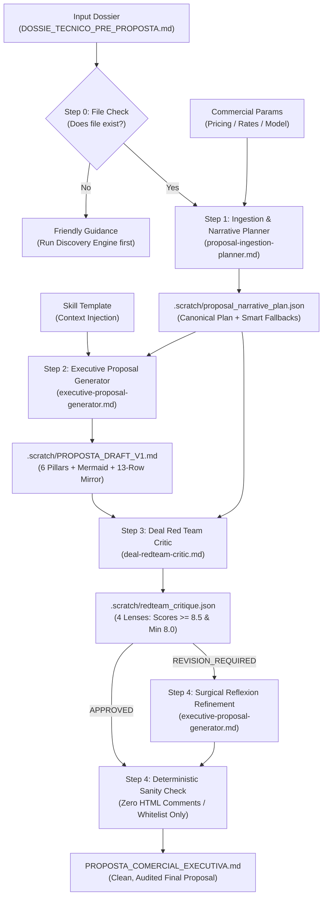

<div align="center">

# Commercial Proposal Engine Plugin
### Global Generator-Critic (Reflexion) Pipeline for Enterprise Software Engineering Proposals

[](https://antigravity.google)
[-EC4899.svg)](#4-generator-critic-reflexion-architecture)
[](./LICENSE)
[](#2-the-6-executive-pillars--contractual-anchoring)

<p align="center">
  <b>Transform pre-sales engineering dossiers (<code>DOSSIE_TECNICO_PRE_PROPOSTA.md</code>) into persuasive, C-Level & CTO-ready Commercial Proposals (<code>PROPOSTA_COMERCIAL_EXECUTIVA.md</code>) that seamlessly anchor binding contract annexes.</b>
</p>

</div>

---

## 1. Strategic Mission: Bridging Pre-Sales Engineering and Legal Execution

In enterprise software engineering, commercial proposals typically fail at one of two extremes:
1. **The Over-Technical Dump:** Dense, disorganized architectural notes that alienate financial sponsors (CEO/CFO), obscuring ROI and business value.
2. **The Superficial Pitch (Slides & Buzzwords):** Vague promises and buzzwords that create major friction and deal breakage when legal teams introduce strict Master Services Agreements (MSAs) and Technical Annexes.

The **Commercial Proposal Engine Plugin** (`commercial-proposal-engine-plugin`, v1.0.0) bridges the gap between the upstream **Discovery-to-Proposal Engine** (`DOSSIE_TECNICO_PRE_PROPOSTA.md`) and the downstream **Contract Technical Annexes Engine** (`ANEXO_TECNICO_MESTRE_CONTRATO.md`).

It synthesizes complex technical reality into a single, cohesive narrative across **6 Executive Pillars** and concludes with a consultative **13-Row Contractual Mirror Table** that anchors every legal and operational parameter ahead of contract execution.

---

## 2. The 6 Executive Pillars & Contractual Anchoring

| Pillar | Subsections & Substance | Target Persona | Downstream Contract Annex Anchored |
| :--- | :--- | :--- | :--- |
| **1. Diagnóstico Executivo & Tese de Valor** | **1.1** As-Is Context & Pains<br>**1.2** To-Be Vision & Impact<br>**1.3** Quantified Return Matrix (Baseline vs. Target KPI Table) | CEO / CFO / Business Directors | Sets baseline business context and measurable acceptance metrics |
| **2. Solução Proposta & Recorte Estratégico** | **2.1** Noun-based Functional Value Modules<br>**2.2** Consultative Out-of-Scope (Legacy migration, outdated browsers, direct cloud billing, N1 support) | Product Owner / VP Product | **Anexo 1 — SOW (Seções 1 e 2)** |
| **3. Fundação Arquitetural, Resiliência & TCO** | **3.1** Tech Stack & Mermaid Container Topology (`["..."]`)<br>**3.2** Critical Integrations, Red Flags & CI/CD Staging Mocks<br>**3.3** InfoSec & LGPD (Controller vs. Operator)<br>**3.4** Transparent Cloud TCO (Direct Client Sourcing) | CTO / Head of Engineering / InfoSec | **Anexo 1 (Seções 2 e 3), Anexo 2 (LGPD) & Anexo 3 (Mocks)** |
| **4. Metodologia de Delivery, Squad & Cronograma** | **4.1** Squad Topology & Seniority Allocation<br>**4.2** Wave Schedule (Milestones, Sprints, or Inception)<br>**4.3** Agility Pact (48h PO SLA, 1:1 Freeze, Standby/Remobilization & 5-day Staging UAT Tacit Approval) | Delivery Lead / PMO / Operations | **Anexo 2 — RACI (Seções 3 e 4) & Anexo 3 — Homologação** |
| **5. Estrutura de Investimento & Propriedade Intelectual** | **5.1** Pricing Models (Modo A: Fixed Milestones, Modo B: Dedicated Squad, Modo C: Inception, or Modo Híbrido: Inception + Construction Estimate)<br>**5.2** Evolution Hourly Rate<br>**5.3** IP Policy (100% Foreground IP upon full payment + Perpetual Background IP License) | CFO / Procurement / Legal | **Anexo 1 — SOW (Seções 4 e 5) & Anexo 4 — Gestão de Mudanças** |
| **6. Governança de Mudanças, Garantia & Kick-off** | **6.1** Budget Protection against Informal Channels (WhatsApp ban, 3-axis CR evaluation)<br>**6.2** 60-day Technical Warranty (SLA P1–P3) vs. Ongoing AMS<br>**6.3** 3-Step Kick-off Onboarding Roadmap | All Stakeholders | **Anexo 4 — Gestão de Mudanças & Anexo 5 — Garantia & SLA** |
| **Anexo Executivo: Quadro de Espelhamento** | **13-Row Consultative Alignment Matrix** bridging proposal conditions directly to Contract Annexes 1–5 in a partnership tone. | General Counsel / Head of Procurement | **Anexos Técnicos 1 a 5 (Consolidação)** |

---

## 3. Directory Structure (100% Antigravity Compliant)

```text
commercial-proposal-engine-plugin/
├── plugin.json
├── README.md
├── LICENSE
├── .gitignore
├── rules/
│   ├── commercial-persuasion-standards.md
│   └── contractual-anchoring-safeguards.md
├── skills/
│   └── commercial-proposal-orchestrator/
│       ├── SKILL.md
│       └── templates/
│           └── PROPOSTA_COMERCIAL_EXECUTIVA.template.md
└── agents/
    ├── proposal-ingestion-planner.md
    ├── executive-proposal-generator.md
    └── deal-redteam-critic.md
```

---

## 4. Generator-Critic (Reflexion) Architecture

Parallelized writing across multiple agents inevitably generates stylistic fractures and contradictory tones ("Frankenstein text"). To guarantee executive unity, the plugin operates in a closed-loop **Generator-Critic (Reflexion)** pipeline:



---

## 5. Installation & Usage

### 5.1 Global Installation

```bash
mkdir -p ~/.gemini/config/plugins/commercial-proposal-engine-plugin
cp -r ./* ~/.gemini/config/plugins/commercial-proposal-engine-plugin/
```

### 5.2 Slash Command Invocation

```bash
/commercial-proposal-orchestrator [dossier_path] [output_dir]
```

*Examples:*
```bash
# Standard execution with default paths:
/commercial-proposal-orchestrator DOSSIE_TECNICO_PRE_PROPOSTA.md ./propostas_comerciais

# Custom path invocation:
/commercial-proposal-orchestrator ./docs/discovery/DOSSIE_TECNICO_PROJETO_ALPHA.md ./output/proposta_alpha
```

Or via natural language conversation:

> *"Gere a proposta comercial executiva a partir do dossiê DOSSIE_TECNICO_PRE_PROPOSTA.md"*

---

## 6. License & Credits

* **Author:** Engineering Architecture Office / HalcyonTech-LTDA
* **Organization:** [HalcyonTech-LTDA](https://github.com/HalcyonTech-LTDA)
* **License:** [MIT](./LICENSE)
