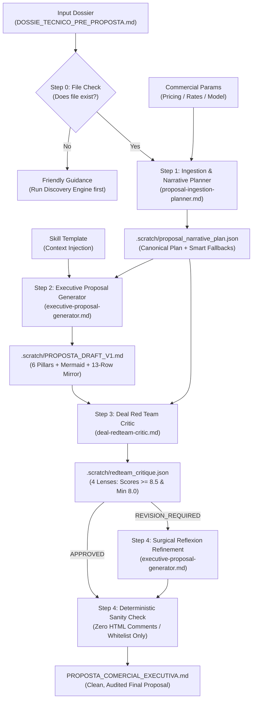

<div align="center">

<a href="https://www.halcyontech.com.br/" target="_blank" rel="noopener noreferrer">
  
</a>

# Commercial Proposal Engine Plugin Plugin
### Global Generator-Critic (Reflexion) Pipeline for Enterprise Software Engineering Proposals

[](https://antigravity.google)
[](./LICENSE)
[](https://www.halcyontech.com.br/)
[](https://github.com/HalcyonTech-LTDA)

<p align="center">
  <b>Pipeline agêntico nativo em arquitetura Generator-Critic (Reflexion) para geração de Propostas Comerciais Executivas de Engenharia de Software a partir de dossiês técnicos de pré-venda.</b>
</p>

</div>

---

## Installation & Verification

### Antigravity CLI (`agy`)

Install directly into your Antigravity environment via the CLI:

```bash
agy plugin install https://github.com/HalcyonTech-LTDA/commercial-proposal-engine-plugin
```

Verify that the plugin is active and adheres to the strict official schema:

```bash
agy plugin list
agy plugin validate --strict ./commercial-proposal-engine-plugin
```

---

## 1. Strategic Mission: Bridging Pre-Sales Engineering and Legal Execution

In enterprise software engineering, commercial proposals typically fail at one of two extremes:
1. **The Over-Technical Dump:** Dense, disorganized architectural notes that alienate financial sponsors (CEO/CFO), obscuring ROI and business value.
2. **The Superficial Pitch (Slides & Buzzwords):** Vague promises and buzzwords that create major friction and deal breakage when legal teams introduce strict Master Services Agreements (MSAs) and Technical Annexes.

The **Commercial Proposal Engine Plugin** (`commercial-proposal-engine-plugin`, v1.0.0) bridges the gap between the upstream **Discovery-to-Proposal Engine** (`DOSSIE_TECNICO_PRE_PROPOSTA.md`) and the downstream **Contract Technical Annexes Engine** (`ANEXO_TECNICO_MESTRE_CONTRATO.md`).

It synthesizes complex technical reality into a single, cohesive narrative across **6 Executive Pillars** and concludes with a consultative **13-Row Contractual Mirror Table** that anchors every legal and operational parameter ahead of contract execution.

---

---

## 2. The 6 Executive Pillars & Contractual Anchoring

| Pillar | Subsections & Substance | Target Persona | Downstream Contract Annex Anchored |
| :--- | :--- | :--- | :--- |
| **1. Diagnóstico Executivo & Tese de Valor** | **1.1** As-Is Context & Pains<br>**1.2** To-Be Vision & Impact<br>**1.3** Quantified Return Matrix (Baseline vs. Target KPI Table) | CEO / CFO / Business Directors | Sets baseline business context and measurable acceptance metrics |
| **2. Solução Proposta & Recorte Estratégico** | **2.1** Noun-based Functional Value Modules<br>**2.2** Consultative Out-of-Scope (Legacy migration, outdated browsers, direct cloud billing, N1 support) | Product Owner / VP Product | **Anexo 1 — SOW (Seções 1 e 2)** |
| **3. Fundação Arquitetural, Resiliência & TCO** | **3.1** Tech Stack & Mermaid Container Topology (`["..."]`)<br>**3.2** Critical Integrations, Red Flags & CI/CD Staging Mocks<br>**3.3** InfoSec & LGPD (Controller vs. Operator)<br>**3.4** Transparent Cloud TCO (Direct Client Sourcing) | CTO / Head of Engineering / InfoSec | **Anexo 1 (Seções 2 e 3), Anexo 2 (LGPD) & Anexo 3 (Mocks)** |
| **4. Metodologia de Delivery, Squad & Cronograma** | **4.1** Squad Topology & Seniority Allocation<br>**4.2** Wave Schedule (Milestones, Sprints, or Inception)<br>**4.3** Agility Pact (48h PO SLA, 1:1 Freeze, Standby/Remobilization & 5-day Staging UAT Tacit Approval) | Delivery Lead / PMO / Operations | **Anexo 2 — RACI (Seções 3 e 4) & Anexo 3 — Homologação** |
| **5. Estrutura de Investimento & Propriedade Intelectual** | **5.1** Pricing Models (Modo A: Fixed Milestones, Modo B: Dedicated Squad, Modo C: Inception, or Modo Híbrido: Inception + Construction Estimate)<br>**5.2** Evolution Hourly Rate<br>**5.3** IP Policy (100% Foreground IP upon full payment + Perpetual Background IP License) | CFO / Procurement / Legal | **Anexo 1 — SOW (Seções 4 e 5) & Anexo 4 — Gestão de Mudanças** |
| **6. Governança de Mudanças, Garantia & Kick-off** | **6.1** Budget Protection against Informal Channels (WhatsApp ban, 3-axis CR evaluation)<br>**6.2** 60-day Technical Warranty (SLA P1–P3) vs. Ongoing AMS<br>**6.3** 3-Step Kick-off Onboarding Roadmap | All Stakeholders | **Anexo 4 — Gestão de Mudanças & Anexo 5 — Garantia & SLA** |
| **Anexo Executivo: Quadro de Espelhamento** | **13-Row Consultative Alignment Matrix** bridging proposal conditions directly to Contract Annexes 1–5 in a partnership tone. | General Counsel / Head of Procurement | **Anexos Técnicos 1 a 5 (Consolidação)** |

---

---

## 4. Generator-Critic (Reflexion) Architecture

Parallelized writing across multiple agents inevitably generates stylistic fractures and contradictory tones ("Frankenstein text"). To guarantee executive unity, the plugin operates in a closed-loop **Generator-Critic (Reflexion)** pipeline:



---

---

## What's Included (Component Catalog)

### Contextual Rules (`rules/`)
Automatically loaded to govern and protect project contexts:
- **[`commercial-persuasion-standards.md`](rules/commercial-persuasion-standards.md)**: Aplicar exclusivamente durante o planejamento, redação ou revisão crítica (Red Team) de propostas comerciais executivas de engenharia de software.
- **[`contractual-anchoring-safeguards.md`](rules/contractual-anchoring-safeguards.md)**: Aplicar exclusivamente durante o planejamento, redação ou revisão crítica (Red Team) de propostas comerciais executivas de engenharia de software para ancorar salvaguardas contratuais.

### Procedural Skills (`skills/`)
On-demand actionable workflows and runbooks:
- **[`/commercial-proposal-orchestrator`](skills/commercial-proposal-orchestrator/SKILL.md)**: Orquestra o pipeline agêntico em loop Generator-Critic (Reflexion) para transformar o dossiê técnico de pré-venda (DOSSIE_TECNICO_PRE_PROPOSTA.md) em uma Proposta Comercial e Técnica Executiva de alto impacto (PROPOSTA_COMERCIAL_EXECUTIVA.md), estruturada nos 6 Pilares Executivos e pré-alinhada com os 5 Anexos Técnicos Contratuais.

### Specialized Subagents (`agents/`)
Autonomous personas delegated for in-depth execution:
- **[`deal-redteam-critic`](agents/deal-redteam-critic.md)**: Atua como Critic no loop Reflexion. Audita a minuta da proposta sob 4 lentes (Persuasão C-Level, Rigor CTO/TCO, Ancoragem dos 5 Anexos Contratuais e Higiene de Output), emitindo parecer estruturado em .scratch/redteam_critique.json.
- **[`executive-proposal-generator`](agents/executive-proposal-generator.md)**: Atua como Generator no loop Reflexion. Redige a Proposta Comercial Executiva completa em voz única e fluida nos 6 pilares e aplica os refinamentos exigidos pelo Deal Red Team Critic.
- **[`proposal-ingestion-planner`](agents/proposal-ingestion-planner.md)**: Analisa o dossiê técnico de pré-venda, valida premissas estruturais, aplica fallbacks comerciais inteligentes e estrutura o plano narrativo da proposta em .scratch/proposal_narrative_plan.json.

---

## Directory Hierarchy

```text
commercial-proposal-engine-plugin/
├── plugin.json              # Official Antigravity manifest (schema v1)
├── LICENSE                  # MIT License (Copyright 2026 HalcyonTech LTDA)
├── .gitignore               # System ignores & installed_version.json exclusions
├── .gitattributes           # Deterministic line endings (* text=auto eol=lf)
├── README.md                # Golden Standard documentation & runbook
├── assets/
│   ├── logo.svg             # Antigravity marketplace square icon
│   └── halcyon-horizontal-cor.svg # Official Halcyon Tech brand logo (white background)             # Official Halcyon Tech corporate vector symbol
├── rules/                   # Contextual rules discovered automatically
│   └── commercial-persuasion-standards.md
│   └── contractual-anchoring-safeguards.md
├── skills/                  # Actionable procedural skills (Progressive Disclosure)
│   └── commercial-proposal-orchestrator/
│       └── SKILL.md
└── agents/                  # Specialized autonomous subagents
    └── deal-redteam-critic.md
    └── executive-proposal-generator.md
    └── proposal-ingestion-planner.md
```

---

## 💡 Prompt Recipes & Use Cases

```markdown
- "Execute o pipeline multi-agente de proposta comercial a partir do dossiê técnico"
- "Audite a viabilidade comercial, margem de risco e premissas contratuais da proposta"
- "Estruture a proposta comercial consolidada com marcos de faturamento e cronograma"
```

---

## 📄 License & Corporate Governance

Distributed under the **MIT License**. Copyright (c) 2026 **HalcyonTech LTDA**.  
Engineered with precision and excellence by [Halcyon Tech](https://www.halcyontech.com.br/) &mdash; [GitHub Organization](https://github.com/HalcyonTech-LTDA).
